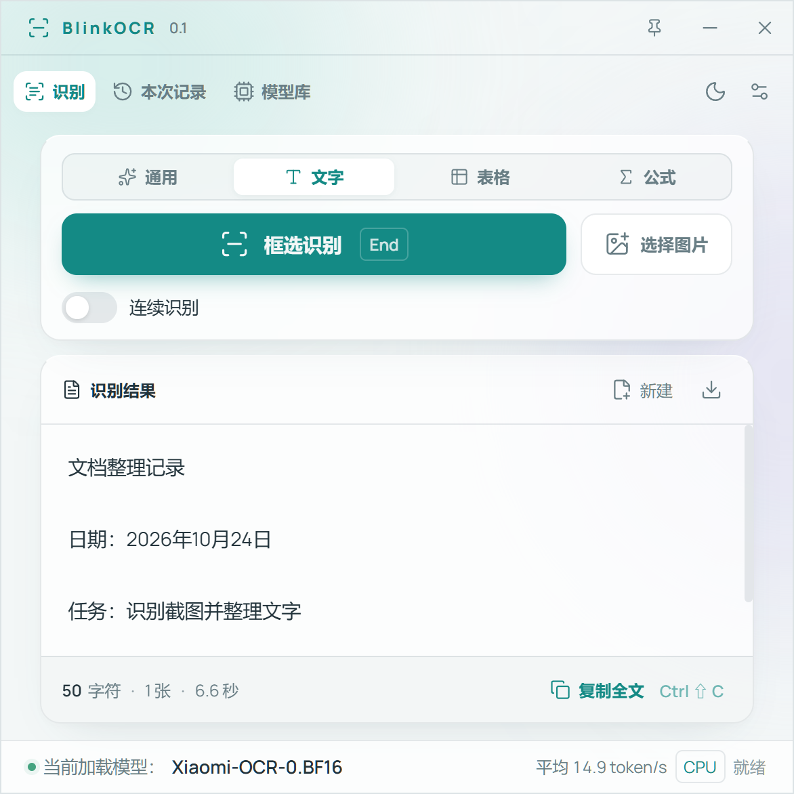

# BlinkOCR

简体中文 · [English](README.en.md)

一款基于Rust开发的Windows 截图 OCR 工具，通过全局快捷键快速截图屏幕进行识别。支持在线模型下载、流式识别、连续识别。Rust 提供内存安全和较低的运行开销，便于直接调用 Windows API、管理本地推理进程并处理并发任务。



## 功能

- **框选与图片识别**：使用快捷键框选屏幕，或打开 PNG、JPEG、WebP、BMP 图片。
- **模型管理**：从 Hugging Face 下载模型，支持暂停、续传、SHA-256 校验及本地文件加载。
- **设备选择**：GGUF 模型优先使用可用的 NVIDIA GPU，按显存分配层数，必要时使用 CPU；PP-OCRv6 使用 ONNX Runtime。
- **结果处理**：流式显示、编辑、复制、保存；连续识别会追加到当前内容之后，并可手动修改。
- **按模型显示任务**：部分模型支持文字、表格、公式、图表等功能切换。
- **版本更新**：启动时可自动检查 GitHub Releases，也可在“关于”中手动检查、下载新版安装包。

## 开始使用

1. 在 [GitHub Releases](https://github.com/1878580314/BlinkOCR/releases) 下载 Windows x64 安装程序（CPU 或 CUDA 版本），运行安装。
2. 打开“模型库”选、下载并加载模型。
3. 模型就绪后按 **End** 框选，或点击“选择图片”。
4. 编辑结果后点击“复制全文”，或按 **Ctrl+Shift+C**。

“设置 → 体验”支持直接按键配置快捷键。默认 **Ctrl+Alt+Q** 退出；关闭窗口会收起到托盘。

安装版为主要发行形式。更新时可通过“关于 → 检查更新”下载对应安装包并运行安装；自动检查可在“设置 → 体验”中开启或关闭。

## 模型

| 模型                           |               参数量 |
| ------------------------------ | -------------------: |
| Xiaomi-OCR-0                   |                 0.8B |
| GLM-OCR                        |                 0.9B |
| PaddleOCR-VL-1.6               |                 0.9B |
| DeepSeek-OCR-2                 |                  3B |
| Unlimited-OCR                  |                  3B |
| Qianfan-OCR                    |                   4B |
| dots.ocr                       |                   3B |
| TeleOCR                        |                 1.2B |
| PP-OCRv6 Tiny / Small / Medium | 1.5M / 7.7M / 34.5M |
| Windows.Media.Ocr              |                      |

模型库包含 11 类可下载模型的 50 个精度或量化版本，以及 Windows 系统组件。

- GGUF 模型需配套视觉投影；TeleOCR 使用单个专用 GGUF 文件。
- PP-OCRv6 使用检测与识别两个 ONNX 文件，字符字典按规格匹配。
- Windows.Media.Ocr 使用系统已安装的 OCR 语言，可在模型设置中选择语言或打开系统语言设置。
- 模型权重单独下载，保存在 `models/`；也可选择其他位置的本地文件。

## 识别设置

CPU 线程默认取逻辑核心数的一半。图像 token 默认使用模型配置；常规模型图片长边为 2048，Windows OCR 为 4000。可根据小字效果与耗时调整，悬停或聚焦设置项可查看说明。

“Xiaomi 表格增强”适用于 Xiaomi-OCR 通用模式的 OTSL 表格。

安装版配置保存在 `%APPDATA%/BlinkOCR/config.rust.toml`，模型默认保存在同一目录下的 `models/`；便携目录可使用程序旁的 `config.rust.toml`。程序不会自动保存截图或识别结果；日志位于 `%APPDATA%/BlinkOCR/logs/`。

## 系统要求

- Windows 10/11 x64、Microsoft Edge WebView2 Runtime 和 [Microsoft Visual C++ v14 x64 Runtime](https://aka.ms/vc14/vc_redist.x64.exe)。
- CUDA 包的 GGUF 后端支持兼容的 NVIDIA 显卡与驱动；CPU 包的 GGUF 后端使用 CPU。两者都包含 PP-OCRv6 与 Windows OCR。
- 内存、显存需求随模型、量化精度、图像尺寸和上下文变化，模型库仅提供相应建议。

## 从源码构建

需要 **Node.js 24+**、**Rust 1.95+（MSVC）**，以及 Visual Studio Build Tools 的“使用 C++ 的桌面开发”和 Windows SDK。安装 [Tauri Windows 前置依赖](https://v2.tauri.app/start/prerequisites/#windows)。

在项目目录运行：

```powershell
npm ci
npm run package:win
```

首次打包会下载固定版本的 llama.cpp 和 TeleOCR，校验 SHA-256，构建程序并收集第三方许可证。检测到 NVIDIA 工具时选择 CUDA 运行时，否则选择 CPU。默认生成 NSIS 安装程序 `dist/BlinkOCR-<版本>-windows-x64-<cpu|cuda>-setup.exe` 及 SHA-256 校验文件。通过 `-OutputDir` 指定其他输出目录。

显式指定运行时：

```powershell
npm run package:win -- -Backend CUDA
npm run package:win -- -Backend CPU
```

运行开发版本：

```powershell
npm run setup:runtime
npm run desktop:dev
```

从 WSL 构建时，指定 Windows 磁盘上的独立构建目录：

```bash
bash scripts/build_windows_blinkocr.sh /mnt/d/build/BlinkOCR CUDA
```

## 关于

作者：[Minayuki](https://github.com/1878580314) · [GitHub 仓库](https://github.com/1878580314/BlinkOCR)

关于页提供当前版本、更新检测、Release 说明和安装包下载。

## 许可证

BlinkOCR 原创应用代码采用 [MIT](LICENSE) 许可证。模型权重、CUDA、DirectML 及其他组件保留各自许可，详见 [第三方声明](THIRD_PARTY_NOTICES.md)。
